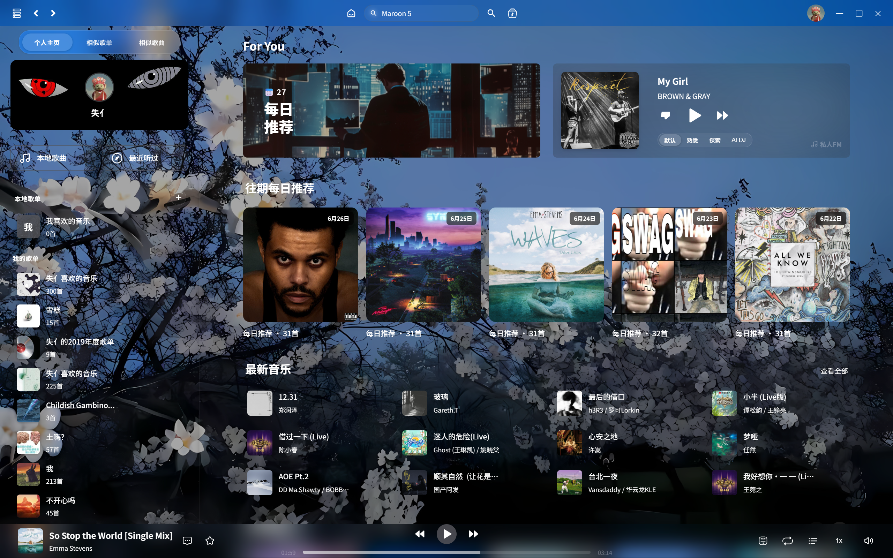
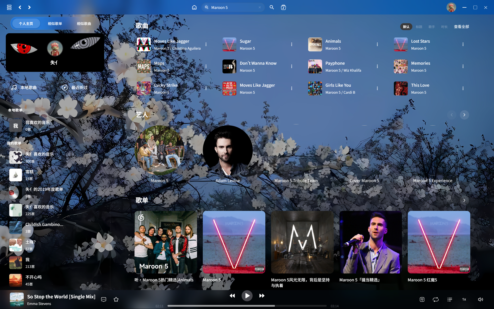
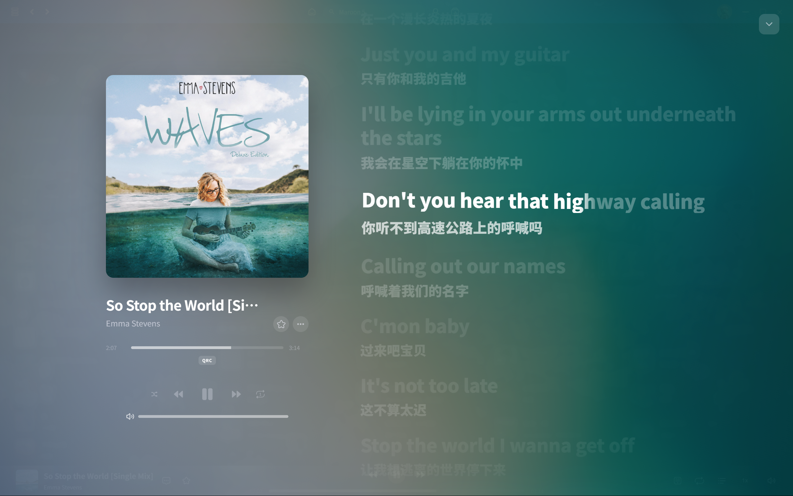

<div align="center">

# PoloMusic

**基于 Vue 3 + Electron 的第三方网易云音乐播放器**

[](https://github.com/smiling11123/polomusic/releases)
[](https://github.com/smiling11123/polomusic-tauri)
[](https://vuejs.org/)
[](https://electronjs.org/)

> **此版本将只发布 release，所有新功能和修复请前往 [Tauri 重构版](https://github.com/smiling11123/polomusic-tauri)。**
>
> Tauri 版体积更小（~15 MB vs ~150 MB）、内存占用更低、内置 Rust 原生音频引擎。

</div>

---

## 效果预览

| 主页 | 搜索 | 歌词 |
|:---:|:---:|:---:|
|  |  |  |

---

## 功能特性

| 类别 | 功能 |
|:---:|:---|
| **播放** | 逐字歌词、类 Apple Music 歌词页面、拖动排序播放列表、音乐解灰、无 VIP 替换试听链接 |
| **推荐** | 每日推荐歌单、私人 FM、最新音乐推荐、精选歌单 |
| **交互** | 窗口快捷键、全局快捷键、评论、本地导入 |
| **账号** | 网易账号登录（手机 / 邮箱 / 扫码 / Cookie） |
| **持久化** | 关闭应用自动保存播放进度与播放列表 |

> **登录说明：** 手机、邮箱和扫码登录目前由于 API 限制无法完美支持，扫码登录较慢（约两分钟）。

---

## 快捷键

| 操作 | 全局快捷键 | 窗口快捷键 |
|:---:|:---:|:---:|
| 播放 / 暂停 | `Ctrl + Alt + C` | `Ctrl + P` |
| 上一首 | `Ctrl + Alt + Z` | `Ctrl + ←` |
| 下一首 | `Ctrl + Alt + X` | `Ctrl + →` |

---

## 快速开始

### 1. 克隆项目

```bash
git clone https://github.com/smiling11123/polomusic.git
cd polomusic
```

### 2. 放置 API 服务

将 [第三方网易云 API](https://github.com/NeteaseCloudMusicApiEnhanced/api-enhanced) 文件夹放入项目根目录。

### 3. 安装依赖

```bash
# 安装前端依赖
npm install

# 安装 API 服务依赖
cd net && npm install && cd ..
```

### 4. 启动开发环境

```bash
npm run electron:dev
```

| 服务 | 默认端口 |
|:---:|:---:|
| Vue 前端 | `5173` |
| Net API | `3000` |

> 也可以将 Net API [部署在服务器](https://github.com/NeteaseCloudMusicApiEnhanced/api-enhanced) 以减轻本地占用。

---

## 致谢

| 项目 | 说明 |
|:---:|:---|
| [NeteaseCloudMusicApiEnhanced](https://github.com/NeteaseCloudMusicApiEnhanced/api-enhanced) | 第三方网易云 API |
| [UnblockNeteaseMusic](https://github.com/UnblockNeteaseMusic/server) | 音乐解灰服务 |
| [YesPlayMusic](https://github.com/qier222/YesPlayMusic) | 灵感来源 |
| [网易云音乐](https://music.163.com/) | 原始设计参考 |

---

## 开发说明

修改、二次分发请注明出处。

---

<div align="center">

**技术栈：** Vue 3 · Electron · Pinia · Vue Router · TypeScript

</div>
